<h1><strong>Решение задания 1 - Баг-репорты</strong></h1>

<table>
<tr>
    <th>Поле</th>
    <th>Значение</th>
</tr>
<tr>
    <td><strong>Окружение:</strong></td>
    <td>Статический скриншот страницы (десктопная версия, ширина от 1022 до 1280px). Точные ОС и браузер не установлены, так как источником анализа являются скриншоты, а не работающий сайт.</td>
</tr>
<tr>
    <td><strong>Предусловия:</strong></td>
    <td>Пользователь заполнил форму редактирования объявления, сохранил изменения и открыл полученную карточку продавца и карточку товара. Истиной для сравнения данных считается скриншот «Форма редактирования».</td>
</tr>
</table>

<h2>Форма редактирования</h2>

<h3>Двойной заголовок "Внешний вид"</h3>
<table>
<tr>
    <th>Поле</th>
    <th>Значение</th>
</tr>
<tr>
    <td><strong>ID бага:</strong></td>
    <td>EDIT-BUG-001</td>
</tr>
<tr>
    <td><strong>Приоритет:</strong></td>
    <td>P1</td>
</tr>
<tr>
    <td><strong>Серьезность:</strong></td>
    <td>Low</td>
</tr>
<tr>
    <td><strong>Описание / Пояснение:</strong></td>
    <td>На странице видны два заголовка, которые портят общий внешний вид формы</td>
</tr>
<tr>
    <td><strong>Фактический результат:</strong></td>
    <td>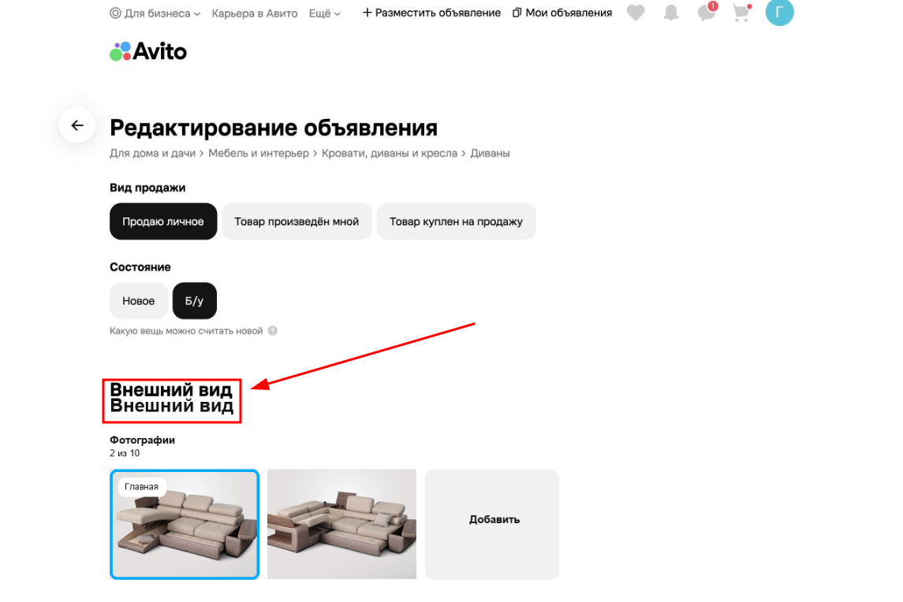</td>
</tr>
<tr>
    <td><strong>Ожидаемый результат:</strong></td>
    <td>1 Заголовок "Внешний вид"</td>
</tr>
</table>

<h3>Слишком большой отступ логотипа от основного блока формы редактирования</h3>
<table>
<tr>
    <th>Поле</th>
    <th>Значение</th>
</tr>
<tr>
    <td><strong>ID бага:</strong></td>
    <td>EDIT-BUG-002</td>
</tr>
<tr>
    <td><strong>Приоритет:</strong></td>
    <td>P3</td>
</tr>
<tr>
    <td><strong>Серьезность:</strong></td>
    <td>Low</td>
</tr>
<tr>
    <td><strong>Описание / Пояснение:</strong></td>
    <td>Слишком сильный отступ между логотипом и формой может броситься в глаза пользователей и испортить имидж компании</td>
</tr>
<tr>
    <td><strong>Фактический результат:</strong></td>
    <td>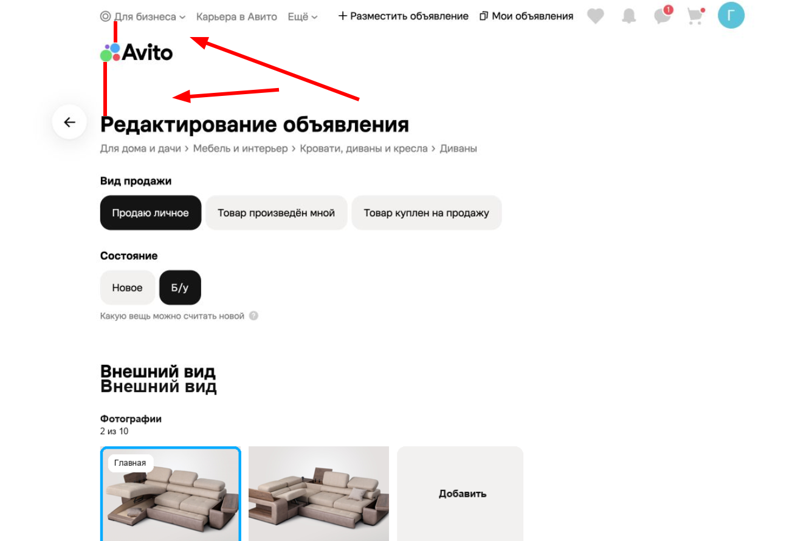</td>
</tr>
<tr>
    <td><strong>Ожидаемый результат:</strong></td>
    <td>Отступ во всех страницах не вызывают внимание пользователей</td>
</tr>
</table>

<h3>Обводка и углы картины несовпадают</h3>
<table>
<tr>
    <th>Поле</th>
    <th>Значение</th>
</tr>
<tr>
    <td><strong>ID бага:</strong></td>
    <td>EDIT-BUG-003</td>
</tr>
<tr>
    <td><strong>Приоритет:</strong></td>
    <td>P3</td>
</tr>
<tr>
    <td><strong>Серьезность:</strong></td>
    <td>Low</td>
</tr>
<tr>
    <td><strong>Описание / Пояснение:</strong></td>
    <td>Из-за отсутствия округленных уголков фотографии - при обводки видны прямые углы фотографии</td>
</tr>
<tr>
    <td><strong>Фактический результат:</strong></td>
    <td>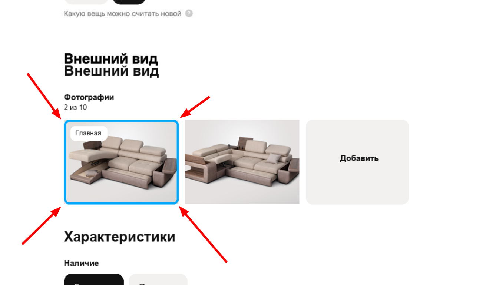</td>
</tr>
<tr>
    <td><strong>Ожидаемый результат:</strong></td>
    <td>Фотографии-миниатюры имеют округленные углы</td>
</tr>
</table>

<h2>Карточка продавца</h2>

<h3>Блок названия товара и цена вышли налево за общую границу</h3>
<table>
<tr>
    <th>Поле</th>
    <th>Значение</th>
</tr>
<tr>
    <td><strong>ID бага:</strong></td>
    <td>SELLER-BUG-001</td>
</tr>
<tr>
    <td><strong>Приоритет:</strong></td>
    <td>P1</td>
</tr>
<tr>
    <td><strong>Серьезность:</strong></td>
    <td>Medium</td>
</tr>
<tr>
    <td><strong>Описание / Пояснение:</strong></td>
    <td>Важный блок информации сдвинулся с общей границы, что вызывает имиджный ущерб</td>
</tr>
<tr>
    <td><strong>Фактический результат:</strong></td>
    <td>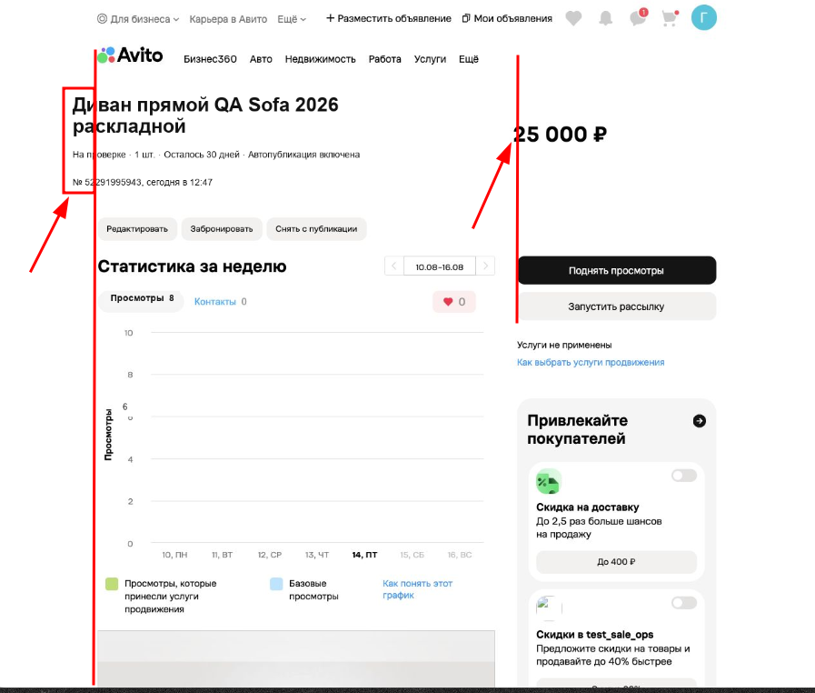</td>
</tr>
<tr>
    <td><strong>Ожидаемый результат:</strong></td>
    <td>Данный блок находится на общей границе с другими блоками</td>
</tr>
</table>

<h3>Текст кнопки сдвинулся выше центра</h3>
<table>
<tr>
    <th>Поле</th>
    <th>Значение</th>
</tr>
<tr>
    <td><strong>ID бага:</strong></td>
    <td>SELLER-BUG-002</td>
</tr>
<tr>
    <td><strong>Приоритет:</strong></td>
    <td>P3</td>
</tr>
<tr>
    <td><strong>Серьезность:</strong></td>
    <td>Low</td>
</tr>
<tr>
    <td><strong>Описание / Пояснение:</strong></td>
    <td>Кнопка сдвинулся вверх, вызывает косметический дефект</td>
</tr>
<tr>
    <td><strong>Фактический результат:</strong></td>
    <td>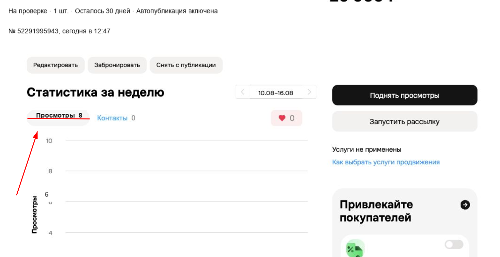</td>
</tr>
<tr>
    <td><strong>Ожидаемый результат:</strong></td>
    <td>Текст кнопки находится в центре кнопки</td>
</tr>
</table>

<h3>Заголовки дашборда некорректно отображается</h3>
<table>
<tr>
    <th>Поле</th>
    <th>Значение</th>
</tr>
<tr>
    <td><strong>ID бага:</strong></td>
    <td>SELLER-BUG-003</td>
</tr>
<tr>
    <td><strong>Приоритет:</strong></td>
    <td>P2</td>
</tr>
<tr>
    <td><strong>Серьезность:</strong></td>
    <td>Medium</td>
</tr>
<tr>
    <td><strong>Описание / Пояснение:</strong></td>
    <td>Значение 6 наложилось на изначальный вид заголовки "6" у дашборда, пользователю важно видеть четкие значения для анализа</td>
</tr>
<tr>
    <td><strong>Фактический результат:</strong></td>
    <td>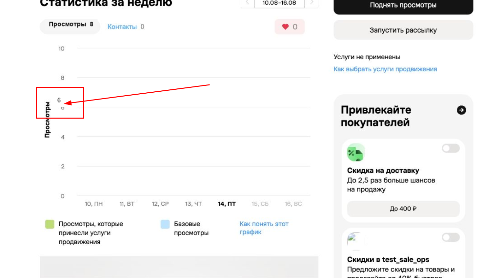</td>
</tr>
<tr>
    <td><strong>Ожидаемый результат:</strong></td>
    <td>Четко отображены заголовки дашборда без каких-то клонирований значений</td>
</tr>
</table>

<h3>Не загружается картина в блоке скидок</h3>
<table>
<tr>
    <th>Поле</th>
    <th>Значение</th>
</tr>
<tr>
    <td><strong>ID бага:</strong></td>
    <td>SELLER-BUG-004</td>
</tr>
<tr>
    <td><strong>Приоритет:</strong></td>
    <td>P3</td>
</tr>
<tr>
    <td><strong>Серьезность:</strong></td>
    <td>Low</td>
</tr>
<tr>
    <td><strong>Описание / Пояснение:</strong></td>
    <td>У раздела Скидки, у одной из 2 карточек не получилось вытянуть картину, косметический дефект</td>
</tr>
<tr>
    <td><strong>Фактический результат:</strong></td>
    <td>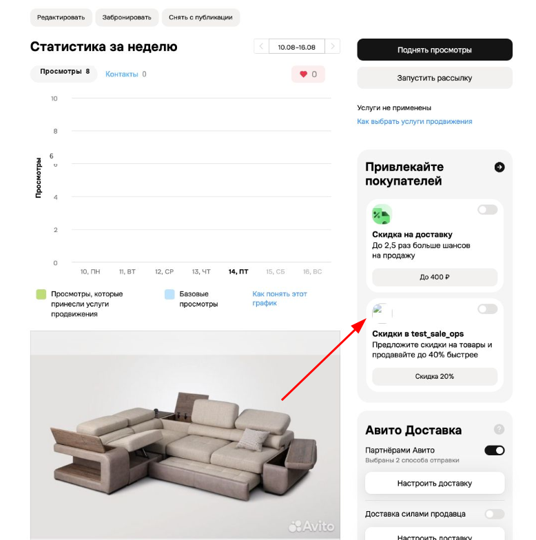</td>
</tr>
<tr>
    <td><strong>Ожидаемый результат:</strong></td>
    <td>Отображается картина</td>
</tr>
</table>

<h3>Отображение название переменной вместо пользовательского текста</h3>
<table>
<tr>
    <th>Поле</th>
    <th>Значение</th>
</tr>
<tr>
    <td><strong>ID бага:</strong></td>
    <td>SELLER-BUG-005</td>
</tr>
<tr>
    <td><strong>Приоритет:</strong></td>
    <td>P3</td>
</tr>
<tr>
    <td><strong>Серьезность:</strong></td>
    <td>Low</td>
</tr>
<tr>
    <td><strong>Описание / Пояснение:</strong></td>
    <td>Данный баг ограничивает пользователя в понимании акции и может повлиять на продажи услуг</td>
</tr>
<tr>
    <td><strong>Фактический результат:</strong></td>
    <td>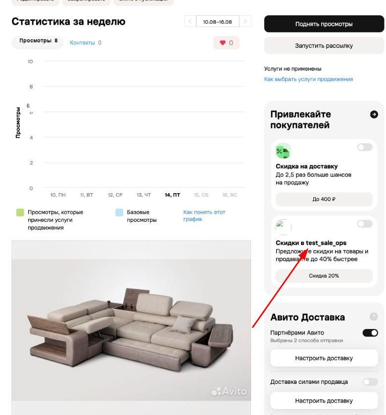</td>
</tr>
<tr>
    <td><strong>Ожидаемый результат:</strong></td>
    <td>Отображается читаемая пользователю текст</td>
</tr>
</table>

<h3>Отображение неверной информации статистики</h3>
<table>
<tr>
    <th>Поле</th>
    <th>Значение</th>
</tr>
<tr>
    <td><strong>ID бага:</strong></td>
    <td>SELLER-BUG-006</td>
</tr>
<tr>
    <td><strong>Приоритет:</strong></td>
    <td>P1</td>
</tr>
<tr>
    <td><strong>Серьезность:</strong></td>
    <td>High</td>
</tr>
<tr>
    <td><strong>Описание / Пояснение:</strong></td>
    <td>Некорректно отображается общая статистика для объявления</td>
</tr>
<tr>
    <td><strong>Фактический результат:</strong></td>
    <td>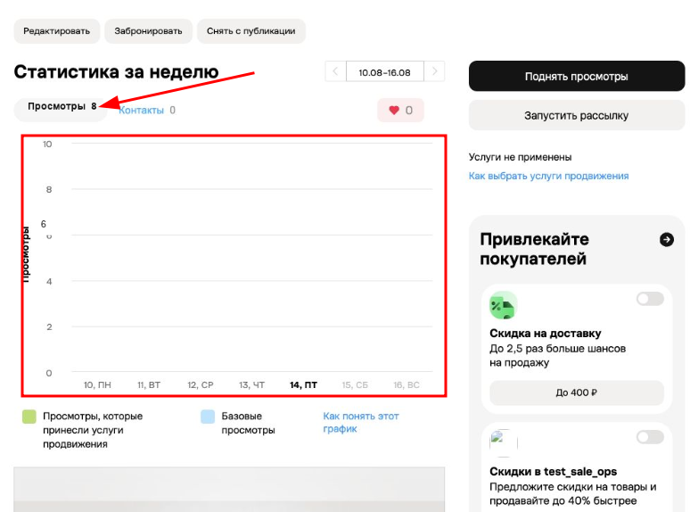</td>
</tr>
<tr>
    <td><strong>Ожидаемый результат:</strong></td>
    <td>Отображается верное количество просмотров в соответствии информации на дашборде</td>
</tr>
</table>

<h3>Грамматические ошибки у карточки</h3>
<table>
<tr>
    <th>Поле</th>
    <th>Значение</th>
</tr>
<tr>
    <td><strong>ID бага:</strong></td>
    <td>SELLER-BUG-007</td>
</tr>
<tr>
    <td><strong>Приоритет:</strong></td>
    <td>P3</td>
</tr>
<tr>
    <td><strong>Серьезность:</strong></td>
    <td>Low</td>
</tr>
<tr>
    <td><strong>Описание / Пояснение:</strong></td>
    <td>Грамматические ошибки портят имидж одной из крупнейших компаний России</td>
</tr>
<tr>
    <td><strong>Фактический результат:</strong></td>
    <td>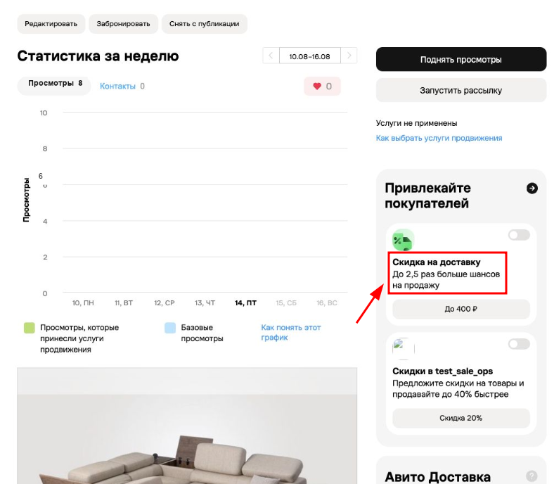</td>
</tr>
<tr>
    <td><strong>Ожидаемый результат:</strong></td>
    <td>Текст - "В 2,5 раза больше шансов на продажу"</td>
</tr>
</table>

<h3>Некорректная последовательность фотографии</h3>
<table>
<tr>
    <th>Поле</th>
    <th>Значение</th>
</tr>
<tr>
    <td><strong>ID бага:</strong></td>
    <td>SELLER-BUG-008</td>
</tr>
<tr>
    <td><strong>Приоритет:</strong></td>
    <td>P2</td>
</tr>
<tr>
    <td><strong>Серьезность:</strong></td>
    <td>Medium</td>
</tr>
<tr>
    <td><strong>Описание / Пояснение:</strong></td>
    <td>Некорректная последовательность фотографии ломает придуманную презентацию продукта продавцом, что сказывается негативно на UX</td>
</tr>
<tr>
    <td><strong>Фактический результат:</strong></td>
    <td>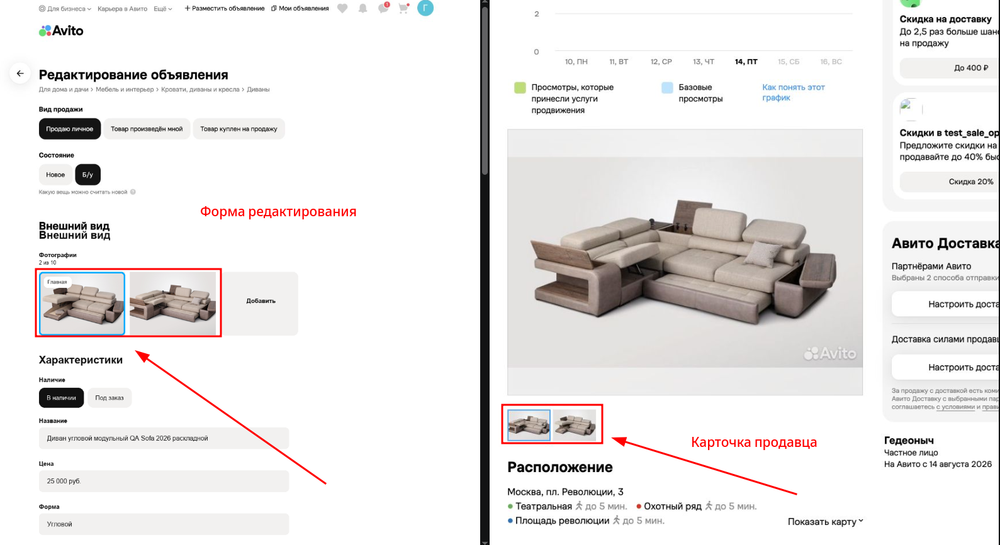</td>
</tr>
<tr>
    <td><strong>Ожидаемый результат:</strong></td>
    <td>Фотография в верной последовательности находятся, так как были указаны при создании и редактирования</td>
</tr>
</table>

<h3>Название на карточке продавца не соответствует с названием на форме редактирования</h3>
<table>
<tr>
    <th>Поле</th>
    <th>Значение</th>
</tr>
<tr>
    <td><strong>ID бага:</strong></td>
    <td>SELLER-BUG-009</td>
</tr>
<tr>
    <td><strong>Приоритет:</strong></td>
    <td>P0</td>
</tr>
<tr>
    <td><strong>Серьезность:</strong></td>
    <td>Critical</td>
</tr>
<tr>
    <td><strong>Описание / Пояснение:</strong></td>
    <td>Критически опасный баг, который не изменяет принятые изменения, нарушен функционал редактирования карточки</td>
</tr>
<tr>
    <td><strong>Фактический результат:</strong></td>
    <td>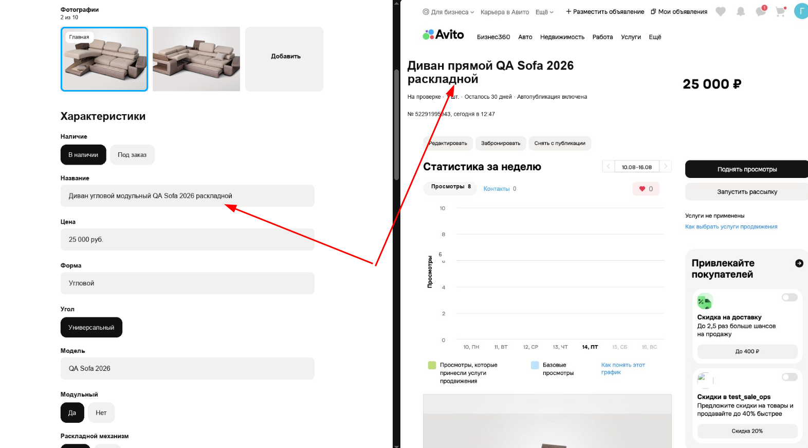</td>
</tr>
<tr>
    <td><strong>Ожидаемый результат:</strong></td>
    <td>Названия на карточке продавца должен совпадать с названием на форме редактирования</td>
</tr>
</table>

<h3>Название параметра характеристики на карточке продавца не совпадает с названием параметра на форме редактирования</h3>
<table>
<tr>
    <th>Поле</th>
    <th>Значение</th>
</tr>
<tr>
    <td><strong>ID бага:</strong></td>
    <td>SELLER-BUG-010</td>
</tr>
<tr>
    <td><strong>Приоритет:</strong></td>
    <td>P3</td>
</tr>
<tr>
    <td><strong>Серьезность:</strong></td>
    <td>Low</td>
</tr>
<tr>
    <td><strong>Описание / Пояснение:</strong></td>
    <td>На карточке продавца вместо "Наличие" указано "Доступность"</td>
</tr>
<tr>
    <td><strong>Фактический результат:</strong></td>
    <td>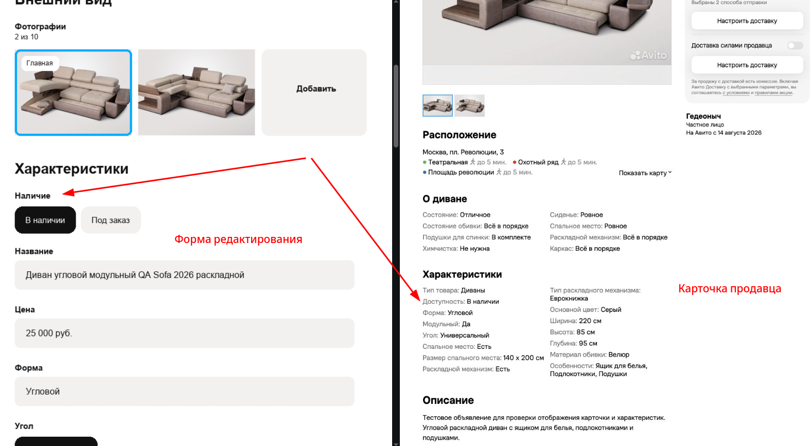</td>
</tr>
<tr>
    <td><strong>Ожидаемый результат:</strong></td>
    <td>Название параметра на карточке продавца должен совпадать с названием параметра на форме редактирования</td>
</tr>
</table>

<h3>Отсутствует пункт "Цвет от производителя" как на форме редактирования</h3>
<table>
<tr>
    <th>Поле</th>
    <th>Значение</th>
</tr>
<tr>
    <td><strong>ID бага:</strong></td>
    <td>SELLER-BUG-011</td>
</tr>
<tr>
    <td><strong>Приоритет:</strong></td>
    <td>P3</td>
</tr>
<tr>
    <td><strong>Серьезность:</strong></td>
    <td>Medium</td>
</tr>
<tr>
    <td><strong>Описание / Пояснение:</strong></td>
    <td>Важно указать все характеристики товара, чтобы показать полную информацию покупателям</td>
</tr>
<tr>
    <td><strong>Фактический результат:</strong></td>
    <td>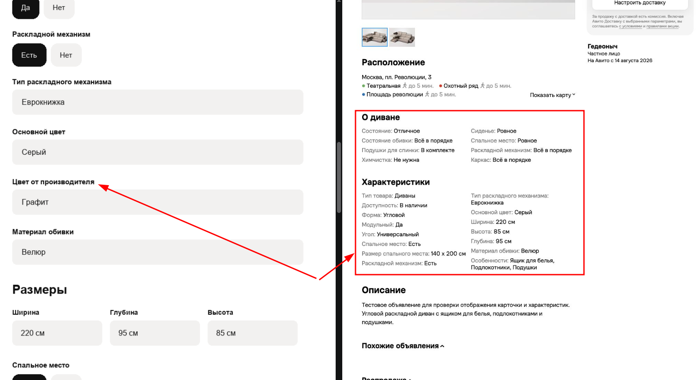</td>
</tr>
<tr>
    <td><strong>Ожидаемый результат:</strong></td>
    <td>Все пункты характеристики должны отображаться на карточках продавца, которые есть в форме редактирования</td>
</tr>
</table>

<h3>Описание товара на карточке продавца не совпадает с описанием в форме редактирования</h3>
<table>
<tr>
    <th>Поле</th>
    <th>Значение</th>
</tr>
<tr>
    <td><strong>ID бага:</strong></td>
    <td>SELLER-BUG-012</td>
</tr>
<tr>
    <td><strong>Приоритет:</strong></td>
    <td>P0</td>
</tr>
<tr>
    <td><strong>Серьезность:</strong></td>
    <td>Critical</td>
</tr>
<tr>
    <td><strong>Описание / Пояснение:</strong></td>
    <td>Текст описания у карточки продавца не совпадает с текстом описания у формы редактирования</td>
</tr>
<tr>
    <td><strong>Фактический результат:</strong></td>
    <td>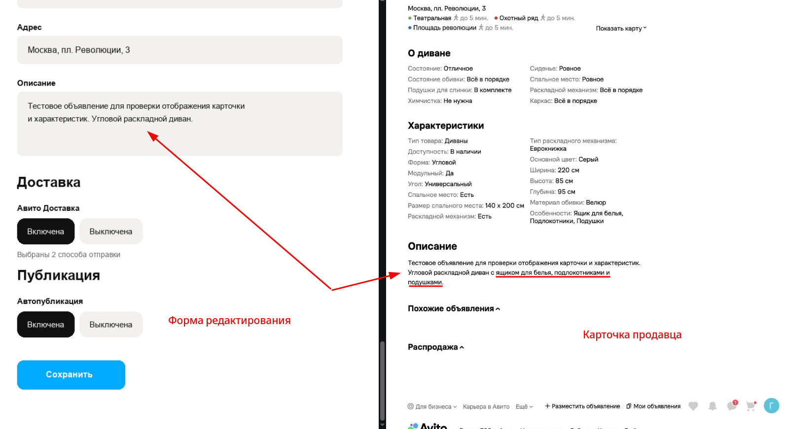</td>
</tr>
<tr>
    <td><strong>Ожидаемый результат:</strong></td>
    <td>Текст описания у формы и карточки продавца должны совпадать</td>
</tr>
</table>

<h3>Отсутствуют объявления для раздела "Похожие объявления" и "Распродажа"</h3>
<table>
<tr>
    <th>Поле</th>
    <th>Значение</th>
</tr>
<tr>
    <td><strong>ID бага:</strong></td>
    <td>SELLER-BUG-013</td>
</tr>
<tr>
    <td><strong>Приоритет:</strong></td>
    <td>P1</td>
</tr>
<tr>
    <td><strong>Серьезность:</strong></td>
    <td>High</td>
</tr>
<tr>
    <td><strong>Описание / Пояснение:</strong></td>
    <td>Основной функционал не нарушен, но нарушен второстепенный, который имеет важную часть в работе - рекомендовательный механизм, стоит знак, что раздел раскрыт для просмотра, но после раскрытия нет объявлений</td>
</tr>
<tr>
    <td><strong>Фактический результат:</strong></td>
    <td>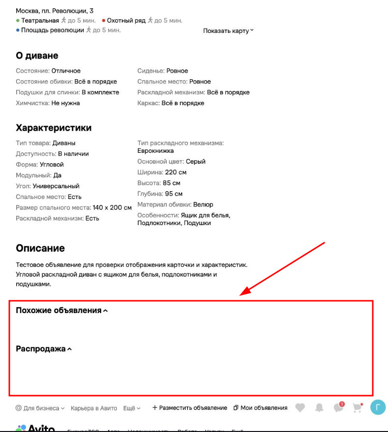</td>
</tr>
<tr>
    <td><strong>Ожидаемый результат:</strong></td>
    <td>Объявления должны отображаться в разделах "Похожие объявления" и "Распродажа" после раскрытия</td>
</tr>
</table>

<h3>Лишняя шапка сайта в конце</h3>
<table>
<tr>
    <th>Поле</th>
    <th>Значение</th>
</tr>
<tr>
    <td><strong>ID бага:</strong></td>
    <td>SELLER-BUG-014</td>
</tr>
<tr>
    <td><strong>Приоритет:</strong></td>
    <td>P2</td>
</tr>
<tr>
    <td><strong>Серьезность:</strong></td>
    <td>Medium</td>
</tr>
<tr>
    <td><strong>Описание / Пояснение:</strong></td>
    <td>Не нарушает основной функционал, но сильно ломает имидж компании и надежность сайта</td>
</tr>
<tr>
    <td><strong>Фактический результат:</strong></td>
    <td>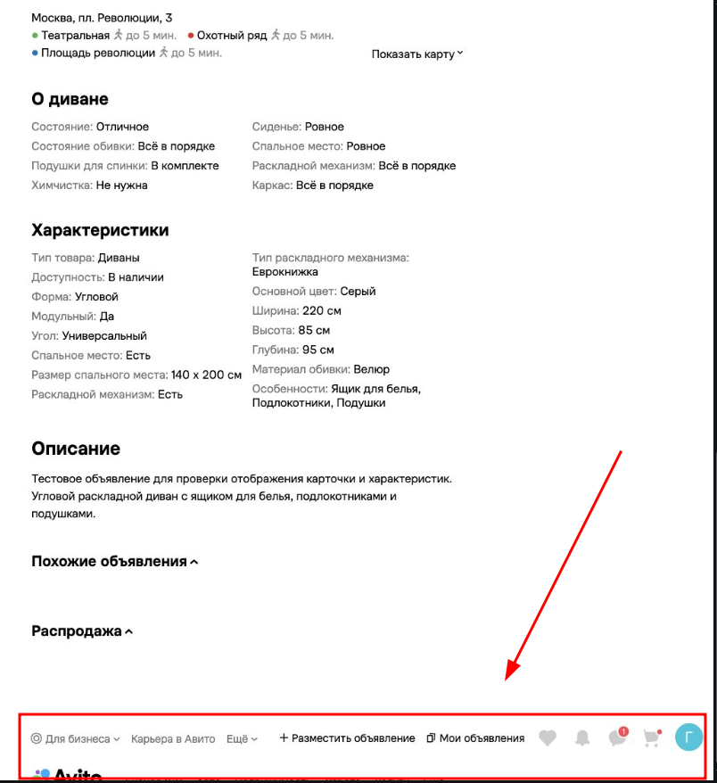</td>
</tr>
<tr>
    <td><strong>Ожидаемый результат:</strong></td>
    <td>Единственная шапка сайта находится сверху</td>
</tr>
</table>

<h3>Лишний пункт характеристики</h3>
<table>
<tr>
    <th>Поле</th>
    <th>Значение</th>
</tr>
<tr>
    <td><strong>ID бага:</strong></td>
    <td>SELLER-BUG-015</td>
</tr>
<tr>
    <td><strong>Приоритет:</strong></td>
    <td>P1</td>
</tr>
<tr>
    <td><strong>Серьезность:</strong></td>
    <td>High</td>
</tr>
<tr>
    <td><strong>Описание / Пояснение:</strong></td>
    <td>В форме редактировании отсутствует пункт "Особенности", в то время на карточке продавца отображается информация о особенностях товара</td>
</tr>
<tr>
    <td><strong>Фактический результат:</strong></td>
    <td>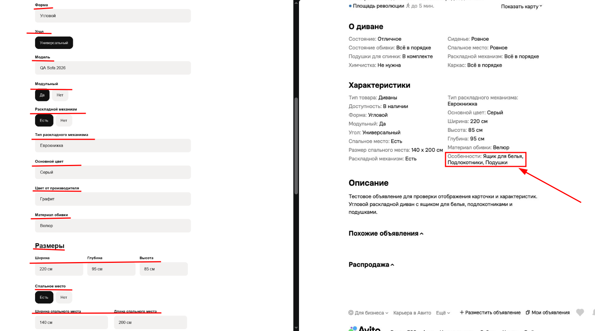</td>
</tr>
<tr>
    <td><strong>Ожидаемый результат:</strong></td>
    <td>Характеристика товара на карточке продавца должна соответствовать форме редактирования</td>
</tr>
</table>

<h3>Неверный текст у кнопки</h3>
<table>
<tr>
    <th>Поле</th>
    <th>Значение</th>
</tr>
<tr>
    <td><strong>ID бага:</strong></td>
    <td>SELLER-BUG-016</td>
</tr>
<tr>
    <td><strong>Приоритет:</strong></td>
    <td>P3</td>
</tr>
<tr>
    <td><strong>Серьезность:</strong></td>
    <td>Low</td>
</tr>
<tr>
    <td><strong>Описание / Пояснение:</strong></td>
    <td>Карточка предлагает сделать скидку до 40%, но кнопка пишет о 20%</td>
</tr>
<tr>
    <td><strong>Фактический результат:</strong></td>
    <td>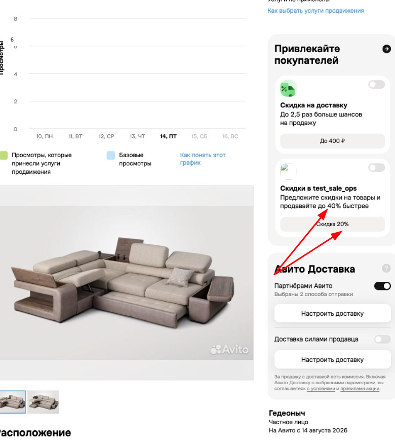</td>
</tr>
<tr>
    <td><strong>Ожидаемый результат:</strong></td>
    <td>Кнопка должна содержать текст "Скидка 40%"</td>
</tr>
</table>

<h3>"Забронировать" кнопка отображается на странице карточки продавца</h3>
<table>
<tr>
    <th>Поле</th>
    <th>Значение</th>
</tr>
<tr>
    <td><strong>ID бага:</strong></td>
    <td>SELLER-BUG-017</td>
</tr>
<tr>
    <td><strong>Приоритет:</strong></td>
    <td>P2</td>
</tr>
<tr>
    <td><strong>Серьезность:</strong></td>
    <td>Medium</td>
</tr>
<tr>
    <td><strong>Описание / Пояснение:</strong></td>
    <td>Нарущена логика идентификации пользователя, пользователь смотрит свой товар и не должен иметь возможность его забронировать</td>
</tr>
<tr>
    <td><strong>Фактический результат:</strong></td>
    <td>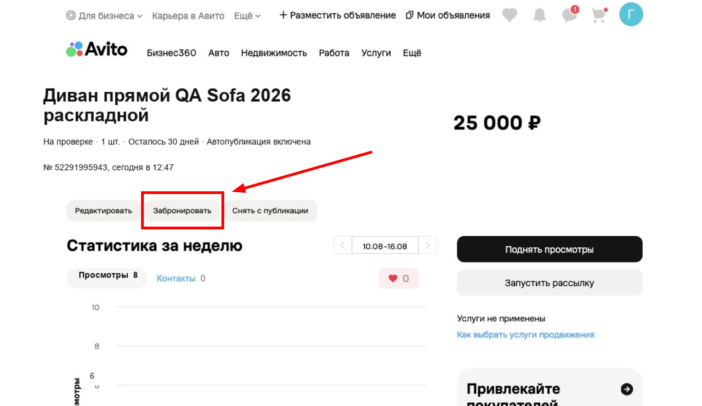</td>
</tr>
<tr>
    <td><strong>Ожидаемый результат:</strong></td>
    <td>Кнопка "Забронировать" не должны отображаться на карточке продавца</td>
</tr>
</table>

<h3>Две кнопки "Настроить доставку" кнопки отображаются рядом друг с другом</h3>
<table>
<tr>
    <th>Поле</th>
    <th>Значение</th>
</tr>
<tr>
    <td><strong>ID бага:</strong></td>
    <td>SELLER-BUG-018</td>
</tr>
<tr>
    <td><strong>Приоритет:</strong></td>
    <td>P2</td>
</tr>
<tr>
    <td><strong>Серьезность:</strong></td>
    <td>Medium</td>
</tr>
<tr>
    <td><strong>Описание / Пояснение:</strong></td>
    <td>Две кнопки, выполняющие одну и ту же функцию, расположены рядом</td>
</tr>
<tr>
    <td><strong>Фактический результат:</strong></td>
    <td></td>
</tr>
<tr>
    <td><strong>Ожидаемый результат:</strong></td>
    <td>Отображается только 1 кнопка "Настроить доставку"</td>
</tr>
</table>

<h2>Карточка товара</h2>

<h3>Цена не обновилась после редактирования</h3>
<table>
<tr>
    <th>Поле</th>
    <th>Значение</th>
</tr>
<tr>
    <td><strong>ID бага:</strong></td>
    <td>ITEM-BUG-001</td>
</tr>
<tr>
    <td><strong>Приоритет:</strong></td>
    <td>P0</td>
</tr>
<tr>
    <td><strong>Серьезность:</strong></td>
    <td>Critical</td>
</tr>
<tr>
    <td><strong>Описание / Пояснение:</strong></td>
    <td>Нарушен важный функционал, цена не зафиксировалась после редактирования товара (В форме редактирования товар стоит 25000 рублей)</td>
</tr>
<tr>
    <td><strong>Фактический результат:</strong></td>
    <td>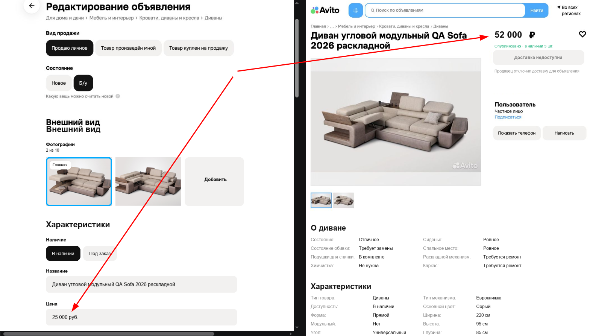</td>
</tr>
<tr>
    <td><strong>Ожидаемый результат:</strong></td>
    <td>Карточка товара должна содержать цену, указанную после редактирования товара</td>
</tr>
</table>

<h3>Количество товара не изменилось после редактирования</h3>
<table>
<tr>
    <th>Поле</th>
    <th>Значение</th>
</tr>
<tr>
    <td><strong>ID бага:</strong></td>
    <td>ITEM-BUG-002</td>
</tr>
<tr>
    <td><strong>Приоритет:</strong></td>
    <td>P0</td>
</tr>
<tr>
    <td><strong>Серьезность:</strong></td>
    <td>Critical</td>
</tr>
<tr>
    <td><strong>Описание / Пояснение:</strong></td>
    <td>Нарушен важный функционал, количество товара не изменилось после редактирования (В форме редактирования указано 1 шт)</td>
</tr>
<tr>
    <td><strong>Фактический результат:</strong></td>
    <td>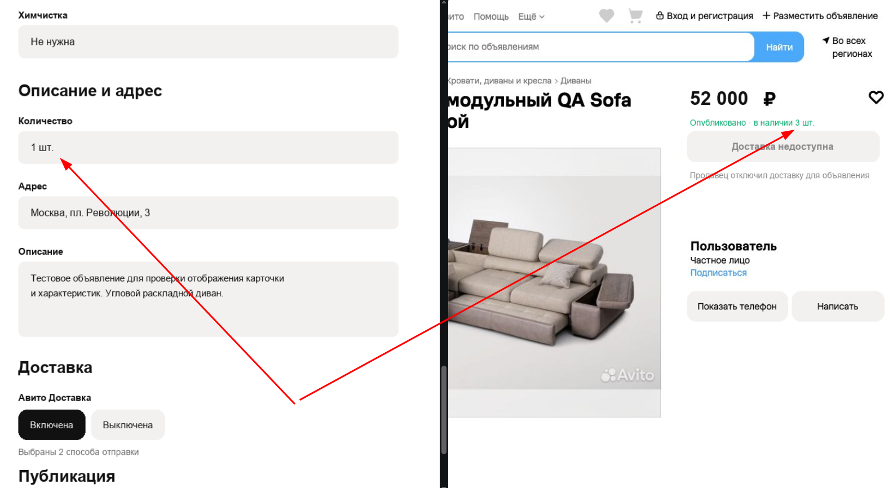</td>
</tr>
<tr>
    <td><strong>Ожидаемый результат:</strong></td>
    <td>Карточка товара должна содержать количество товара, указанное в форме редактирования</td>
</tr>
</table>

<h3>Кнопка, отвечающая за доставку, недоступна после редактирования на возможную доставки</h3>
<table>
<tr>
    <th>Поле</th>
    <th>Значение</th>
</tr>
<tr>
    <td><strong>ID бага:</strong></td>
    <td>ITEM-BUG-003</td>
</tr>
<tr>
    <td><strong>Приоритет:</strong></td>
    <td>P0</td>
</tr>
<tr>
    <td><strong>Серьезность:</strong></td>
    <td>Critical</td>
</tr>
<tr>
    <td><strong>Описание / Пояснение:</strong></td>
    <td>Нарушен важный функционал, после редактирования товара на возможную доставку, на карточке товара, кнопка, отвечающая за доставку, недоступна; баг ограничивает пользователя в фунционале</td>
</tr>
<tr>
    <td><strong>Фактический результат:</strong></td>
    <td>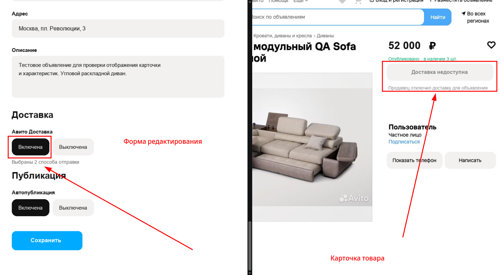</td>
</tr>
<tr>
    <td><strong>Ожидаемый результат:</strong></td>
    <td>Кнопка должна быть кликабельной после открытия возможности доставки через редактирования</td>
</tr>
</table>

<h3>Блок пользователя на карточке товара не указывает на профиль продавца</h3>
<table>
<tr>
    <th>Поле</th>
    <th>Значение</th>
</tr>
<tr>
    <td><strong>ID бага:</strong></td>
    <td>ITEM-BUG-004</td>
</tr>
<tr>
    <td><strong>Приоритет:</strong></td>
    <td>P2</td>
</tr>
<tr>
    <td><strong>Серьезность:</strong></td>
    <td>Medium</td>
</tr>
<tr>
    <td><strong>Описание / Пояснение:</strong></td>
    <td>Блок пользователя на карточке товара содержит только запись "Частное лицо" и "Подтверждён", но не ссылается на профиль самого продавца. Аватар в шапке страницы к этому блоку не относится, поэтому связаться с конкретным продавцом и перейти в его профиль нельзя.</td>
</tr>
<tr>
    <td><strong>Фактический результат:</strong></td>
    <td>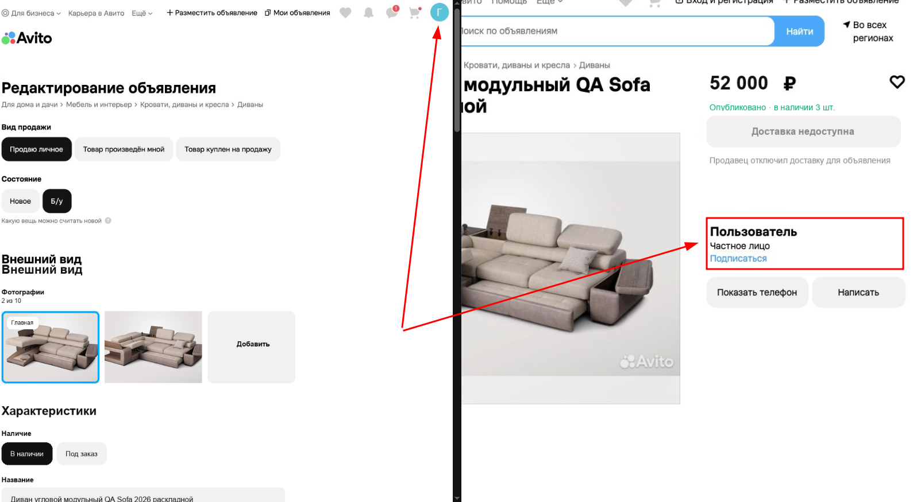</td>
</tr>
<tr>
    <td><strong>Ожидаемый результат:</strong></td>
    <td>Блок пользователя должен вести на профиль продавца и содержать заметный контакт или ссылку на продавца объявления</td>
</tr>
</table>

<h3>Фотографий на карточке товара отображаются некорректно</h3>
<table>
<tr>
    <th>Поле</th>
    <th>Значение</th>
</tr>
<tr>
    <td><strong>ID бага:</strong></td>
    <td>ITEM-BUG-005</td>
</tr>
<tr>
    <td><strong>Приоритет:</strong></td>
    <td>P2</td>
</tr>
<tr>
    <td><strong>Серьезность:</strong></td>
    <td>Medium</td>
</tr>
<tr>
    <td><strong>Описание / Пояснение:</strong></td>
    <td>Фотография на карточке товара отображаются не в той последовательности, что указаны в форме редактирования</td>
</tr>
<tr>
    <td><strong>Фактический результат:</strong></td>
    <td>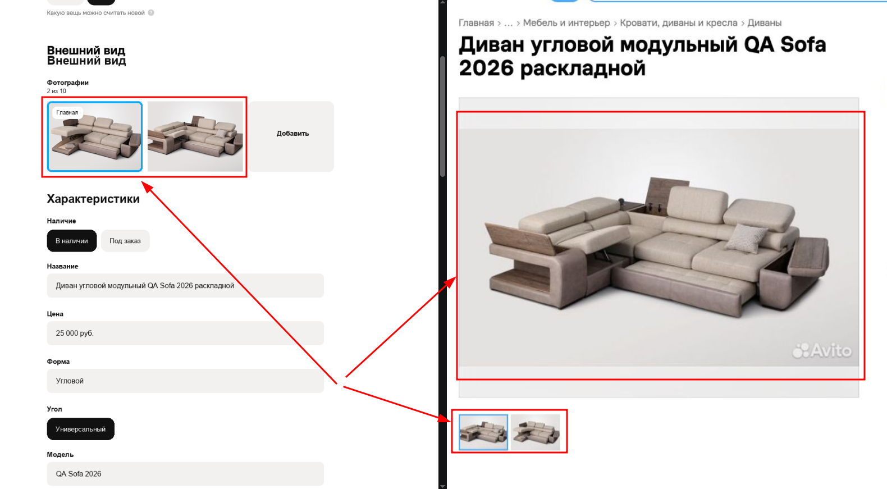</td>
</tr>
<tr>
    <td><strong>Ожидаемый результат:</strong></td>
    <td>Фотографии отображаются в правильной последовательности, что задана в форме редактирования</td>
</tr>
</table>

<h3>Блок кнопок сдвинута направо относительно от общей границы страницы</h3>
<table>
<tr>
    <th>Поле</th>
    <th>Значение</th>
</tr>
<tr>
    <td><strong>ID бага:</strong></td>
    <td>ITEM-BUG-006</td>
</tr>
<tr>
    <td><strong>Приоритет:</strong></td>
    <td>P3</td>
</tr>
<tr>
    <td><strong>Серьезность:</strong></td>
    <td>Low</td>
</tr>
<tr>
    <td><strong>Описание / Пояснение:</strong></td>
    <td>Блок кнопок сверху сдвинута направо по сравнению с блоком кнопок у страницы формы редактирования</td>
</tr>
<tr>
    <td><strong>Фактический результат:</strong></td>
    <td>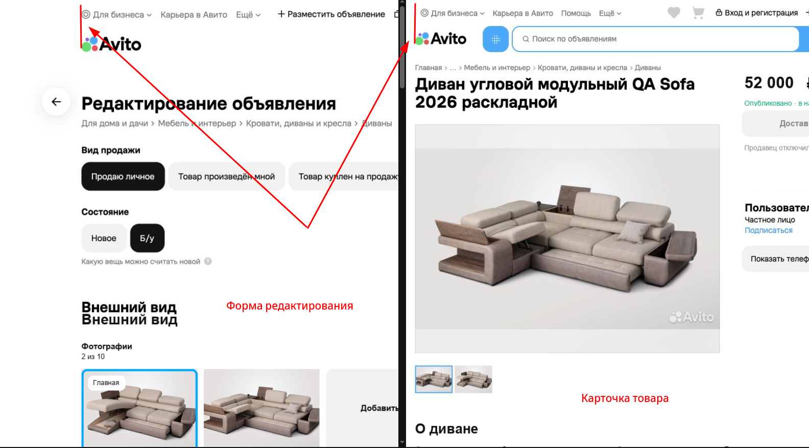</td>
</tr>
<tr>
    <td><strong>Ожидаемый результат:</strong></td>
    <td>Блок кнопок должен стоять на 1 общей границе как на странице формы редактирования</td>
</tr>
</table>

<h3>Карточка товара не отображает измененные состояния товара</h3>
<table>
<tr>
    <th>Поле</th>
    <th>Значение</th>
</tr>
<tr>
    <td><strong>ID бага:</strong></td>
    <td>ITEM-BUG-007</td>
</tr>
<tr>
    <td><strong>Приоритет:</strong></td>
    <td>P0</td>
</tr>
<tr>
    <td><strong>Серьезность:</strong></td>
    <td>Critical</td>
</tr>
<tr>
    <td><strong>Описание / Пояснение:</strong></td>
    <td>После редактирования товара - карточка товара не отображает измененные состояния товара -> теряется актуальная информация товара, приводит к нарушению функционала редактирования товара</td>
</tr>
<tr>
    <td><strong>Фактический результат:</strong></td>
    <td>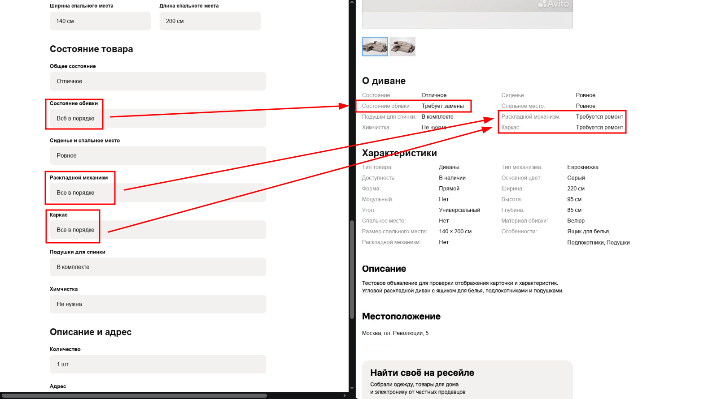</td>
</tr>
<tr>
    <td><strong>Ожидаемый результат:</strong></td>
    <td>После редактирования карточка товара должна содержать состояния товара, указанные в форме редактирования</td>
</tr>
</table>

<h3>Лишний пункт характеристики "Особенности"</h3>
<table>
<tr>
    <th>Поле</th>
    <th>Значение</th>
</tr>
<tr>
    <td><strong>ID бага:</strong></td>
    <td>ITEM-BUG-008</td>
</tr>
<tr>
    <td><strong>Приоритет:</strong></td>
    <td>P1</td>
</tr>
<tr>
    <td><strong>Серьезность:</strong></td>
    <td>High</td>
</tr>
<tr>
    <td><strong>Описание / Пояснение:</strong></td>
    <td>В форме редактировании отсутствует пункт "Особенности", в то время на карточке товара отображается информация о особенностях товара</td>
</tr>
<tr>
    <td><strong>Фактический результат:</strong></td>
    <td>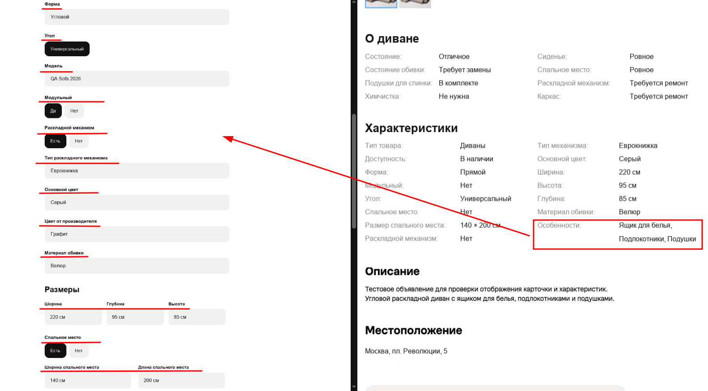</td>
</tr>
<tr>
    <td><strong>Ожидаемый результат:</strong></td>
    <td>"Особенности" не должно отображаться, если в редактировании его нет</td>
</tr>
</table>

<h3>Неактуальные характеристики после редактирования</h3>
<table>
<tr>
    <th>Поле</th>
    <th>Значение</th>
</tr>
<tr>
    <td><strong>ID бага:</strong></td>
    <td>ITEM-BUG-009</td>
</tr>
<tr>
    <td><strong>Приоритет:</strong></td>
    <td>P0</td>
</tr>
<tr>
    <td><strong>Серьезность:</strong></td>
    <td>Critical</td>
</tr>
<tr>
    <td><strong>Описание / Пояснение:</strong></td>
    <td>Несколько характеристиков не соответствуют данным из формы редактирования</td>
</tr>
<tr>
    <td><strong>Фактический результат:</strong></td>
    <td>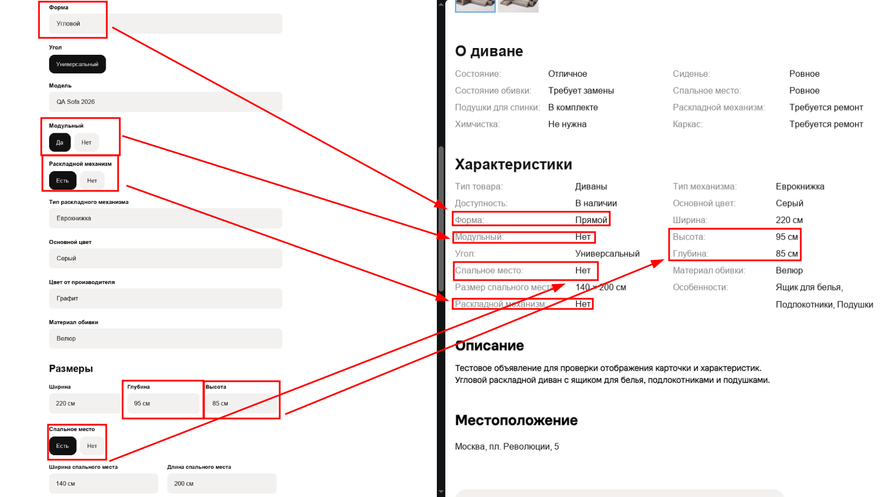</td>
</tr>
<tr>
    <td><strong>Ожидаемый результат:</strong></td>
    <td>Характеристики должны соответствовать данным из формы редактирования</td>
</tr>
</table>

<h3>Блок информации о товаре сдвинулся направо</h3>
<table>
<tr>
    <th>Поле</th>
    <th>Значение</th>
</tr>
<tr>
    <td><strong>ID бага:</strong></td>
    <td>ITEM-BUG-010</td>
</tr>
<tr>
    <td><strong>Приоритет:</strong></td>
    <td>P3</td>
</tr>
<tr>
    <td><strong>Серьезность:</strong></td>
    <td>Low</td>
</tr>
<tr>
    <td><strong>Описание / Пояснение:</strong></td>
    <td>Блок состояния и характеристики товара подвинулся направо. Косметический дефект, портящий общий вид карточки</td>
</tr>
<tr>
    <td><strong>Фактический результат:</strong></td>
    <td>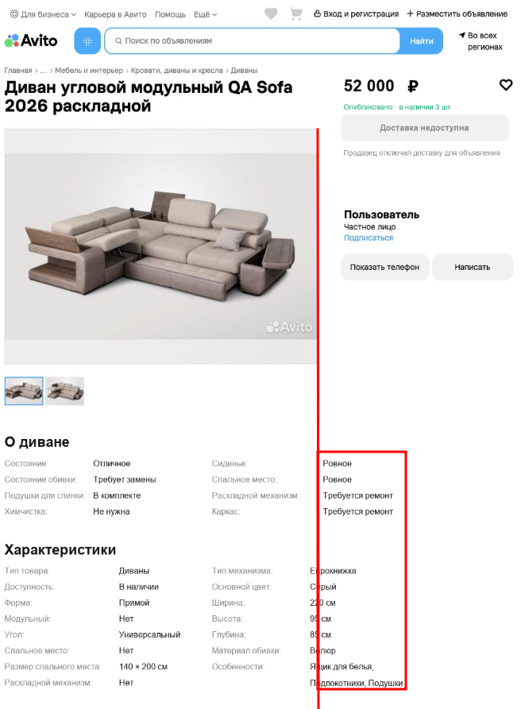</td>
</tr>
<tr>
    <td><strong>Ожидаемый результат:</strong></td>
    <td>Блок состояния и характеристики товара не выходит за границы уделенного блока для объявления</td>
</tr>
</table>

<h3>Заголовок "Описание" подрезан сверху</h3>
<table>
<tr>
    <th>Поле</th>
    <th>Значение</th>
</tr>
<tr>
    <td><strong>ID бага:</strong></td>
    <td>ITEM-BUG-011</td>
</tr>
<tr>
    <td><strong>Приоритет:</strong></td>
    <td>P3</td>
</tr>
<tr>
    <td><strong>Серьезность:</strong></td>
    <td>Low</td>
</tr>
<tr>
    <td><strong>Описание / Пояснение:</strong></td>
    <td>Косметический дефект, портящий вид страницы</td>
</tr>
<tr>
    <td><strong>Фактический результат:</strong></td>
    <td>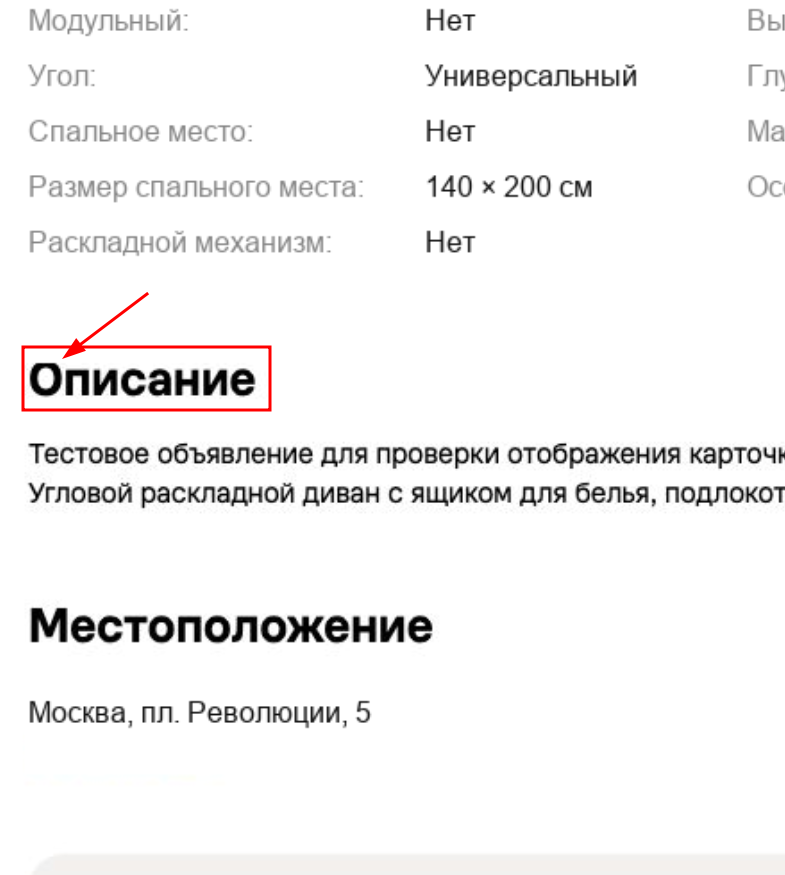</td>
</tr>
<tr>
    <td><strong>Ожидаемый результат:</strong></td>
    <td>Буквы у заголовки отображаются целыми</td>
</tr>
</table>

<h3>Описание в карточке товара не совпадает с описанием в форме редактирования</h3>
<table>
<tr>
    <th>Поле</th>
    <th>Значение</th>
</tr>
<tr>
    <td><strong>ID бага:</strong></td>
    <td>ITEM-BUG-012</td>
</tr>
<tr>
    <td><strong>Приоритет:</strong></td>
    <td>P0</td>
</tr>
<tr>
    <td><strong>Серьезность:</strong></td>
    <td>Critical</td>
</tr>
<tr>
    <td><strong>Описание / Пояснение:</strong></td>
    <td>В форме редактирования поле "Описание" заканчивается на "Угловой раскладной диван", тогда как на карточке товара описание ("...диван с ящиком для белья, подлокотниками и подушками"). Это создаёт впечатление, что текст не изменился после редактирования</td>
</tr>
<tr>
    <td><strong>Фактический результат:</strong></td>
    <td>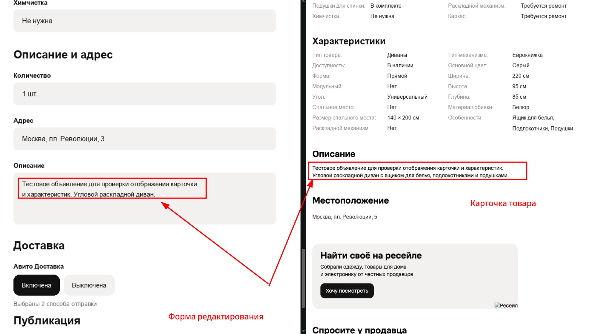</td>
</tr>
<tr>
    <td><strong>Ожидаемый результат:</strong></td>
    <td>Текст описания в форме редактирования отображается полностью и совпадает с текстом на карточке товара</td>
</tr>
</table>

<h3>Нет кнопки "Показать на карте" и информация о ближайших станциях</h3>
<table>
<tr>
    <th>Поле</th>
    <th>Значение</th>
</tr>
<tr>
    <td><strong>ID бага:</strong></td>
    <td>ITEM-BUG-013</td>
</tr>
<tr>
    <td><strong>Приоритет:</strong></td>
    <td>P2</td>
</tr>
<tr>
    <td><strong>Серьезность:</strong></td>
    <td>High</td>
</tr>
<tr>
    <td><strong>Описание / Пояснение:</strong></td>
    <td>Не отображается кнопка для открытия карты, также не отображаются ближайшие станции метро по указанному адресу, что значительно ухудшает UX</td>
</tr>
<tr>
    <td><strong>Фактический результат:</strong></td>
    <td>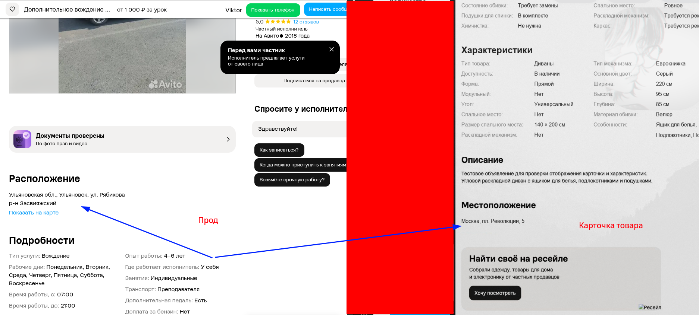</td>
</tr>
<tr>
    <td><strong>Ожидаемый результат:</strong></td>
    <td>В разделе "Местоположение" находится кнопка "Показать на карте" и ближайшие станции метро</td>
</tr>
</table>

<h3>Не отображается картина на карточке</h3>
<table>
<tr>
    <th>Поле</th>
    <th>Значение</th>
</tr>
<tr>
    <td><strong>ID бага:</strong></td>
    <td>ITEM-BUG-014</td>
</tr>
<tr>
    <td><strong>Приоритет:</strong></td>
    <td>P3</td>
</tr>
<tr>
    <td><strong>Серьезность:</strong></td>
    <td>Low</td>
</tr>
<tr>
    <td><strong>Описание / Пояснение:</strong></td>
    <td>Не отображается картина у карточки с заголовком "Найти своё на ресейле" - косметический дефект</td>
</tr>
<tr>
    <td><strong>Фактический результат:</strong></td>
    <td>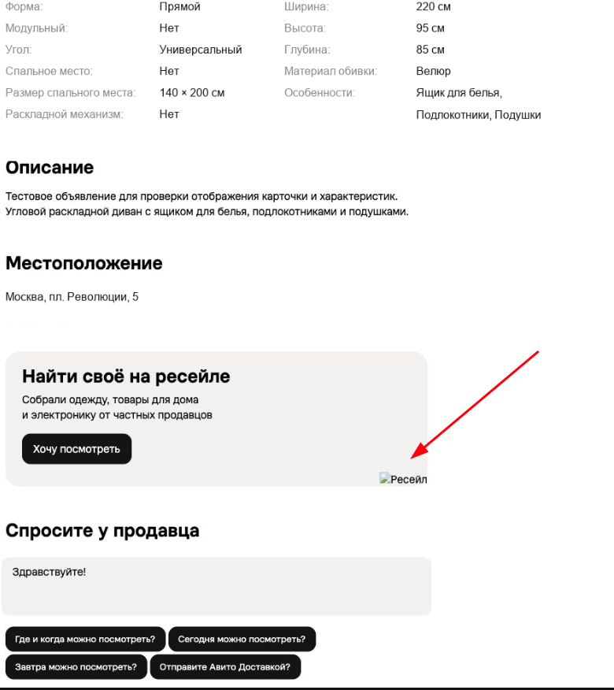</td>
</tr>
<tr>
    <td><strong>Ожидаемый результат:</strong></td>
    <td>Карточка "Найти своё на ресейле" должна иметь отображаемую картину</td>
</tr>
</table>

<h3>Нет кнопки отправки сообщения</h3>
<table>
<tr>
    <th>Поле</th>
    <th>Значение</th>
</tr>
<tr>
    <td><strong>ID бага:</strong></td>
    <td>ITEM-BUG-015</td>
</tr>
<tr>
    <td><strong>Приоритет:</strong></td>
    <td>P2</td>
</tr>
<tr>
    <td><strong>Серьезность:</strong></td>
    <td>Medium</td>
</tr>
<tr>
    <td><strong>Описание / Пояснение:</strong></td>
    <td>Не отображается кнопка для отправки сообщения, вызывает небольшие UX проблемы</td>
</tr>
<tr>
    <td><strong>Фактический результат:</strong></td>
    <td>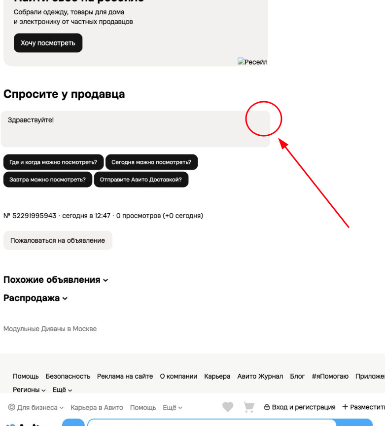</td>
</tr>
<tr>
    <td><strong>Ожидаемый результат:</strong></td>
    <td>Должна отображаться кнопка для отправки сообщения по заготовленным текстам</td>
</tr>
</table>

<h3>Сломанный футер, отображается шапка и футер одновременно</h3>
<table>
<tr>
    <th>Поле</th>
    <th>Значение</th>
</tr>
<tr>
    <td><strong>ID бага:</strong></td>
    <td>ITEM-BUG-016</td>
</tr>
<tr>
    <td><strong>Приоритет:</strong></td>
    <td>P2</td>
</tr>
<tr>
    <td><strong>Серьезность:</strong></td>
    <td>Medium</td>
</tr>
<tr>
    <td><strong>Описание / Пояснение:</strong></td>
    <td>Наложенная шапка на футер негативно сказывается на UX и имидж компании</td>
</tr>
<tr>
    <td><strong>Фактический результат:</strong></td>
    <td>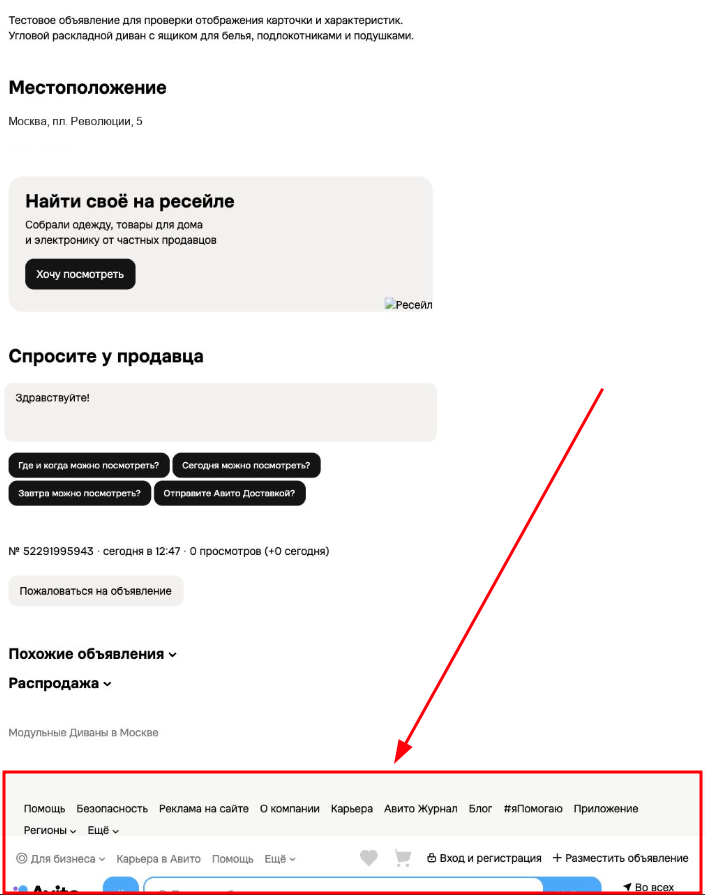</td>
</tr>
<tr>
    <td><strong>Ожидаемый результат:</strong></td>
    <td>Конец страницы содержит только футер</td>
</tr>
</table>
